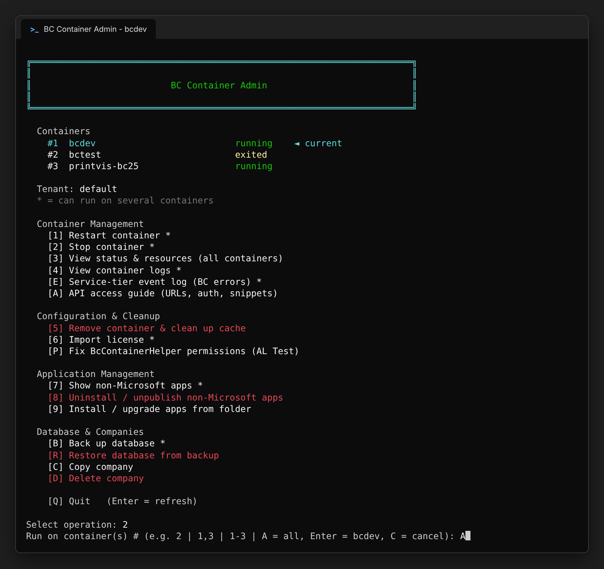
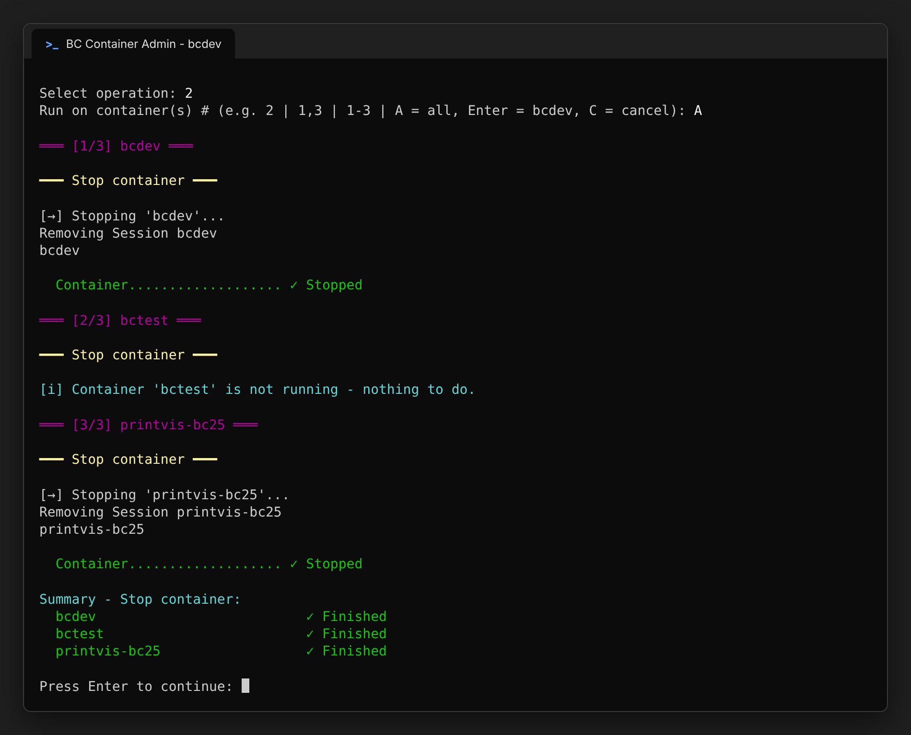
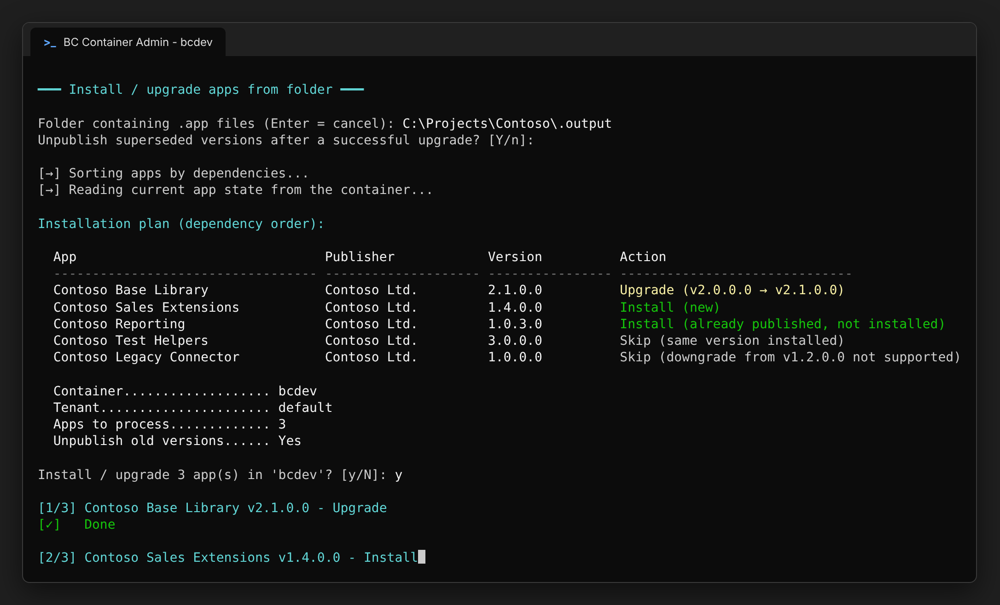
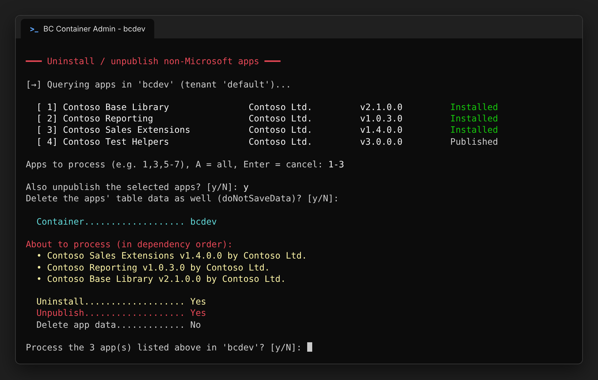
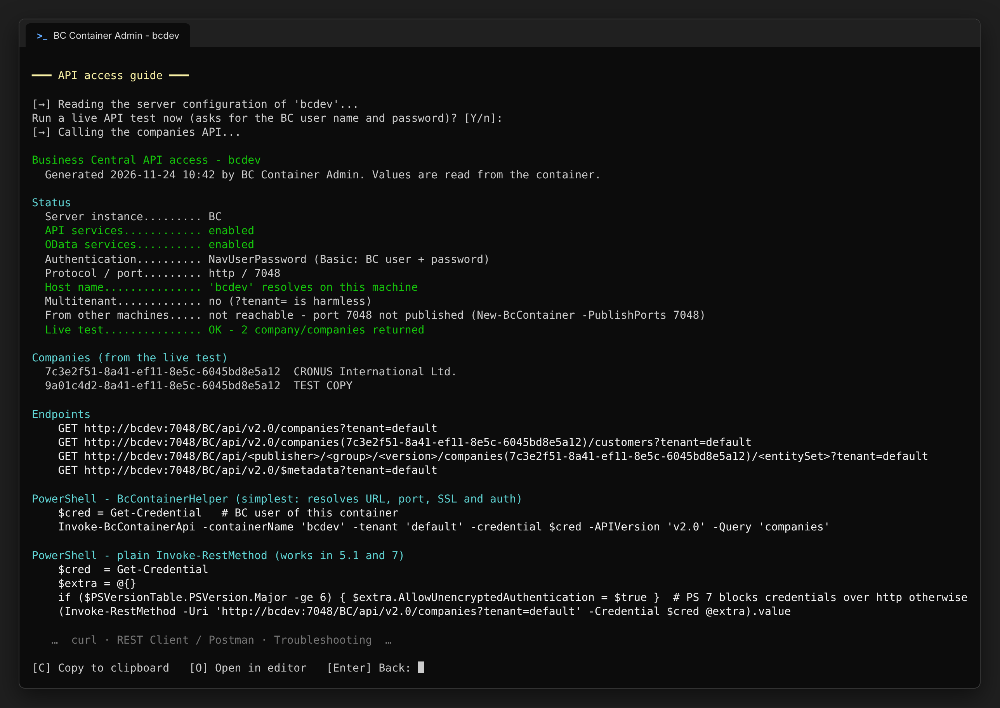

# Business Central Container Admin

[](https://github.com/mbaic/al-ps-container-scripts/actions/workflows/ci.yml)

Interactive PowerShell menu for managing local Business Central Docker containers with [BcContainerHelper](https://github.com/microsoft/navcontainerhelper): container lifecycle, apps, licenses, database backups, companies, logs and API access, all from one screen.

> **Note:** This is a demonstration tool, published to show what's possible with PowerShell and BcContainerHelper for local Business Central container management. It reflects how I work with BC containers in my own development environment. Use it as a starting point and adapt it to your own workflow and needs.



<sub>Screenshots in this README are mocks rendered from the script's exact output format, not live captures.</sub>

---

## Highlights

- **All containers on one screen.** The menu lists every BC container with its state. Each operation asks which container to run on, and Enter keeps the current one. Everyday operations (marked `*`) also run on several containers at once, such as stopping all of them.
- **Safe by default.** Destructive actions show exactly what will happen and ask a y/N question naming the target (Enter = No), and every default is the non-destructive choice.
- **Dependency-aware app handling.** Installs and upgrades run in dependency order, uninstalls run dependents first, and downgrades are detected and skipped.
- **Database backup and restore,** plus copying and deleting companies.
- **Troubleshooting built in:** BC server errors from the container's event log, shown right in the terminal.
- **API access guide:** URLs, auth and ready-to-copy snippets generated from the container's real configuration, with a live API test.
- **Tested in CI:** the script is parsed on PowerShell 5.1 and 7, linted, unit-tested, and checked against the real BcContainerHelper module.

---

## Quick start

```powershell
# Install the prerequisite once
Install-Module BcContainerHelper -Scope CurrentUser
```

```powershell
# Run the menu
.\Admin.Containers.AsMenu.ps1
```

```powershell
# Optional parameters
.\Admin.Containers.AsMenu.ps1 -ContainerName bcdev -LicenseFile 'D:\Licenses\dev.bclicense' -Tenant default
```

| Parameter | Default | Purpose |
|---|---|---|
| `-ContainerName` | first running BC container | Container pre-selected as the default target |
| `-LicenseFile` | `C:\Downloads\BC-License.bclicense` | License offered by **[6] Import license** |
| `-Tenant` | `default` | Tenant used for app, company and API operations |
| `-ExcludedPublisher` | `Microsoft` | Publishers hidden from the "non-Microsoft apps" operations |

Run with `-Verbose` to get script stack traces when an operation fails.

### How container selection works

1. The main menu shows every BC container (`#1`, `#2`, …), its state, and which one is **current**.
2. Pick an operation, then the container number. **Enter** keeps the current container, **C** cancels.
3. The container you used becomes the new current one. With a single container you are never asked.

Container-wide operations ([3] status, [P] permissions) don't ask. Press **Enter** at the main prompt to refresh the list.

### Running on several containers

Operations marked **`*`** in the menu also accept several containers:

```
Run on container(s) # (e.g. 2 | 1,3 | 1-3 | A = all, Enter = bcdev, C = cancel):
```

| Runs on several containers (`*`) | Always one container at a time |
|---|---|
| [1] Restart, [2] Stop, [4] Logs, [E] Event log, [6] Import license, [7] Show apps, [B] Backup | [5] Remove, [8] Uninstall, [R] Restore, [D] Delete company (destructive), [9] Install (the plan differs per container), [C] Copy company (each container has its own company list), [A] API guide |

- **One after another,** never in parallel. Each container gets a heading (`[2/3] bctest`), and a failure on one container doesn't stop the others.
- **Questions are asked once** for the first container and reused for the rest: log line count, event-log view and number of errors, license file and Task Scheduler choice, backup label. Container-specific prompts, such as "start this stopped container?", are still asked per container.
- **A summary** at the end shows each container as ✓ Finished or ✗ Failed, with the error. "Finished" means the operation ran without an error, including when it had nothing to do (e.g. the container was already stopped).
- **The current container doesn't change** after a run on several containers.

A unit test keeps destructive operations from ever being marked multi-container.



---

## Menu reference

### Container Management

| Key | Operation | What it does |
|---|---|---|
| **1** | Restart container `*` | `Restart-BcContainer`, waits until the container is ready again |
| **2** | Stop container `*` | Stops the container; reports "nothing to do" when it is already stopped |
| **3** | View status & resources | All BC containers (name, status, version, country, platform, image) plus CPU, memory, network and disk I/O |
| **4** | View container logs `*` | Last N lines of `docker logs` (default 50, validated). The URLs are printed at each container start, so use a larger number if they aren't in the last 50 lines |
| **E** | Service-tier event log `*` | Shows the last N **BC server errors** in the terminal, with the useful lines picked out: message, error type, user, session type and AL call stack. Or opens the full Application log in Event Viewer (`Get-BcContainerEventLog`) |
| **A** | API access guide | See [API access guide](#api-access-guide) below |

### Configuration & Cleanup

| Key | Operation | What it does |
|---|---|---|
| **5** | Remove container & clean up cache | Confirm with `y` (Enter = No). Only that container is removed; other containers, images and caches are untouched unless you choose a cleanup. Cache cleanup choice: **[1] unused BC artifacts only** (default), [2] full cleanup including unused BC images and `docker image prune`, [3] none |
| **6** | Import license `*` | Default or custom path, optionally disables the Task Scheduler, imports with a service-tier restart only (no full container restart) |
| **P** | Fix BcContainerHelper permissions | `Check-BcContainerHelperPermissions -Fix`, needed for AL Test Runner in VS Code without running as admin |

### Application Management

| Key | Operation | What it does |
|---|---|---|
| **7** | Show non-Microsoft apps `*` | Publisher, name, version, installed state and sync state for the selected tenant |
| **8** | Uninstall / unpublish non-Microsoft apps | Select with `1,3,5-7` or `A`. Processes apps in **dependency order** (dependents first). App data is **kept by default**: deleting it (`doNotSaveData`) is a separate question, default No |
| **9** | Install / upgrade apps from folder | Scans recursively (ignores `.alpackages`), sorts by dependencies, shows a plan, then publishes. Optionally unpublishes the versions an upgrade replaced |



How **[9]** decides what to do with each app (unit-tested; see `Get-InstallPlanEntry`):

| Container state for the app | Action |
|---|---|
| Not present | **Install** |
| Lower version installed | **Upgrade** (data upgrade) |
| Same version installed | **Skip** |
| Higher version installed | **Skip**, because BC cannot downgrade |
| Same version published, not installed | **Install**, reusing the published package |
| Other version published, not installed | **Install**. BcContainerHelper chooses install or data upgrade from the tenant's stored data version (`ExtensionDataVersion`) |



### Database & Companies

| Key | Operation | What it does |
|---|---|---|
| **B** | Back up database `*` | Optional label (e.g. `before-upgrade`). Stored in `C:\ProgramData\BcContainerHelper\Backups\<container>\<yyyyMMdd-HHmmss>[_label]` |
| **R** | Restore database from backup | Lists this container's backups (newest first, with size). Offers a safety backup of the current database first, then asks for `y` to confirm (Enter = No). Data, companies and apps all go back to the backup's state |
| **C** | Copy company | `Copy-CompanyInBcContainer`: new company with all data. Checks the name length (30 characters max) and that the name is unique |
| **D** | Delete company | Offers a backup first (Microsoft's recommendation), asks for `y` to confirm (Enter = No), and refuses to delete the last company. Deletion is immediate |

Backups are never deleted automatically, and each one is the full database size, because SQL Server Express (the edition BC containers normally use) does not support backup compression.

---

## API access guide

**[A]** reads the selected container's real configuration and prints a guide for it:

- **Status:** server instance, API/OData enabled, authentication, protocol and port, whether the container name resolves on this machine (otherwise the container IP is used), multitenancy, and whether the port is published for other machines.
- **Optional live test:** calls the companies API with your Windows login or a BC user you enter, then shows the real company IDs.
- **Snippets for this container:** endpoints, `Invoke-BcContainerApi`, plain `Invoke-RestMethod` (works on PowerShell 5.1 and 7), curl, and REST Client / Postman settings.
- **Troubleshooting:** 405, 401, host not found, certificate errors, empty standard APIs.

Afterwards: **[C]** copies the guide to the clipboard as Markdown, **[O]** opens it in your editor (`%TEMP%\BC-API-<container>.md`). Credentials are never written into the guide, the clipboard or the file.



**Do I need to enable anything?** Usually no. `New-BcContainer` starts every container for BC versions after 11 with `enableApiServices=Y`. If a container returns **HTTP 405**, API services are off: **[A]** detects this and offers to enable them, which needs a restart.

---

## Safety defaults

| Action | Safeguard |
|---|---|
| Remove container | `y` to confirm, Enter = No. Artifacts-only cache cleanup by default; choose **[3] No cache cleanup** to leave every other container's files untouched |
| Uninstall apps | `y` to confirm, Enter = No. App data kept unless you opt in. Dependency order |
| Install / upgrade | Plan shown first, `y` to confirm, Enter = No. Downgrades skipped |
| Restore database | Safety backup offered (default Yes), `y` to confirm, Enter = No |
| Delete company | Backup offered (default Yes), `y` to confirm, Enter = No, last company protected |
| Enable API services | Explicit question, default No (it restarts the container) |

The container is only changed through BcContainerHelper cmdlets; Docker is only used read-only (`ps`, `logs`, `stats`, `port`).

---

## Requirements

- Windows PowerShell 5.1 or PowerShell 7
- Docker running with Windows containers
- [BcContainerHelper](https://www.powershellgallery.com/packages/BcContainerHelper) 6.x
- One or more Business Central containers created with BcContainerHelper
- Administrator rights, or run **[P]** once to fix BcContainerHelper permissions

Keep the script saved as **UTF-8 with BOM**. Windows PowerShell 5.1 garbles the box-drawing characters otherwise, and CI checks this.

---

## Testing & CI

Every push and pull request runs [`.github/workflows/ci.yml`](.github/workflows/ci.yml) on Windows:

| Job | Checks |
|---|---|
| Parse, encoding & lint | Parses under Windows PowerShell 5.1 and PowerShell 7. UTF-8 BOM on all `.ps1` files. PSScriptAnalyzer: errors fail the build, warnings are reported as annotations |
| Unit tests (5.1 and 7) | Pester 5 tests for selection parsing, container selection (single and multiple), multi-container runs (shared questions, failures), install-plan decisions, event-message formatting, guide-to-Markdown conversion, prompts and menu structure |
| BcContainerHelper contract | Installs the real BcContainerHelper module and verifies that every command the script calls exists and accepts every parameter name used, including splatted parameters |

The unit tests load the script's functions from its parsed source without executing it, so they need neither Docker nor BcContainerHelper.

**Not covered by CI:** the container operations themselves. Hosted runners can't run Business Central containers (Windows containers, multi-GB images and a license would be needed). Smoke-test on a throwaway container after changes: [7], [9] new install, [9] upgrade, [8] uninstall, [B], [C], [D], [R], [E], [A], [6], [1], [2], then [5]. With several containers, also run [2] and [1] on `A` (all).

Run the tests locally:

```powershell
Install-Module Pester -MinimumVersion 5.5.0 -Scope CurrentUser -Force -SkipPublisherCheck
```

```powershell
Invoke-Pester ./tests/Admin.Containers.AsMenu.Tests.ps1 -Output Detailed
```

```powershell
Invoke-Pester ./tests/BcContainerHelper.Contract.Tests.ps1 -Output Detailed   # needs BcContainerHelper installed
```

---

## Troubleshooting

### Script runs in PowerShell but has issues in VS Code
- Restart the PowerShell extension: `Ctrl + Shift + P` → "PowerShell: Restart Session"
- Or run it in a standalone PowerShell window.

### No containers listed
- Make sure Docker is running and switched to Windows containers.
- Check `docker ps -a` and `Get-Module -ListAvailable BcContainerHelper`.

### App queries fail with "Get-NavAppInfo is not recognized"
- Usually a stale cached PowerShell session after a restart outside the script. The script resets the session and retries once automatically.

### License import fails
- Check the path and the `.bclicense` extension, and that the container is running.

### App installation errors
- Check that the dependencies are in the folder or already in the container. Look at **[E]** for the server-side error.

### API calls fail
- Run **[A]** with the live test: the status lines and the troubleshooting section point to the cause.

---

## License

MIT License

Copyright (c) 2026 Milos Baic

Permission is hereby granted, free of charge, to any person obtaining a copy of this software and associated documentation files (the "Software"), to deal in the Software without restriction, including without limitation the rights to use, copy, modify, merge, publish, distribute, sublicense, and/or sell copies of the Software, and to permit persons to whom the Software is furnished to do so, subject to the following conditions:

The above copyright notice and this permission notice shall be included in all copies or substantial portions of the Software.

THE SOFTWARE IS PROVIDED "AS IS", WITHOUT WARRANTY OF ANY KIND, EXPRESS OR IMPLIED, INCLUDING BUT NOT LIMITED TO THE WARRANTIES OF MERCHANTABILITY, FITNESS FOR A PARTICULAR PURPOSE AND NONINFRINGEMENT. IN NO EVENT SHALL THE AUTHORS OR COPYRIGHT HOLDERS BE LIABLE FOR ANY CLAIM, DAMAGES OR OTHER LIABILITY, WHETHER IN AN ACTION OF CONTRACT, TORT OR OTHERWISE, ARISING FROM, OUT OF OR IN CONNECTION WITH THE SOFTWARE OR THE USE OR OTHER DEALINGS IN THE SOFTWARE.
